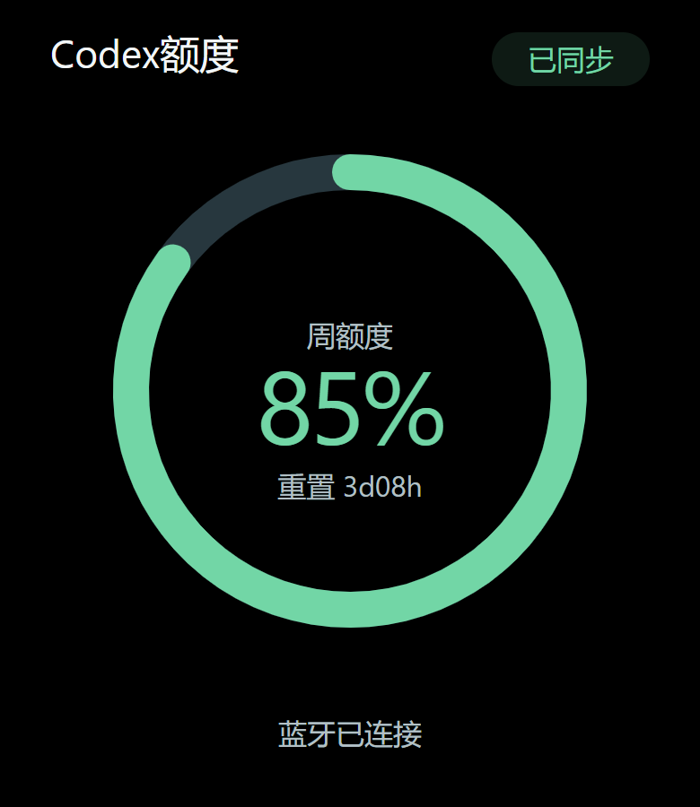
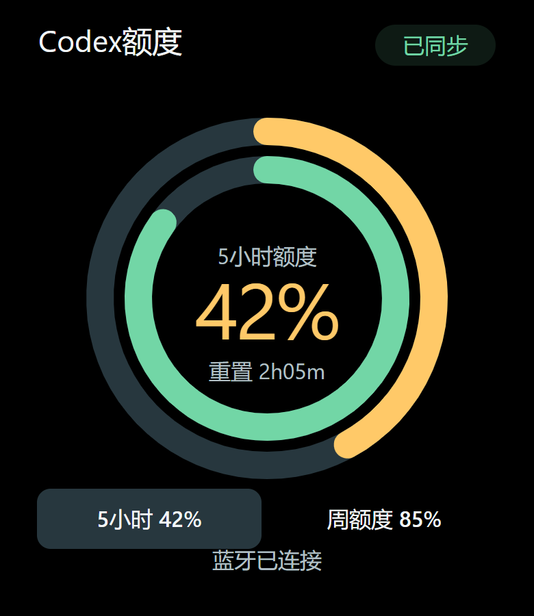
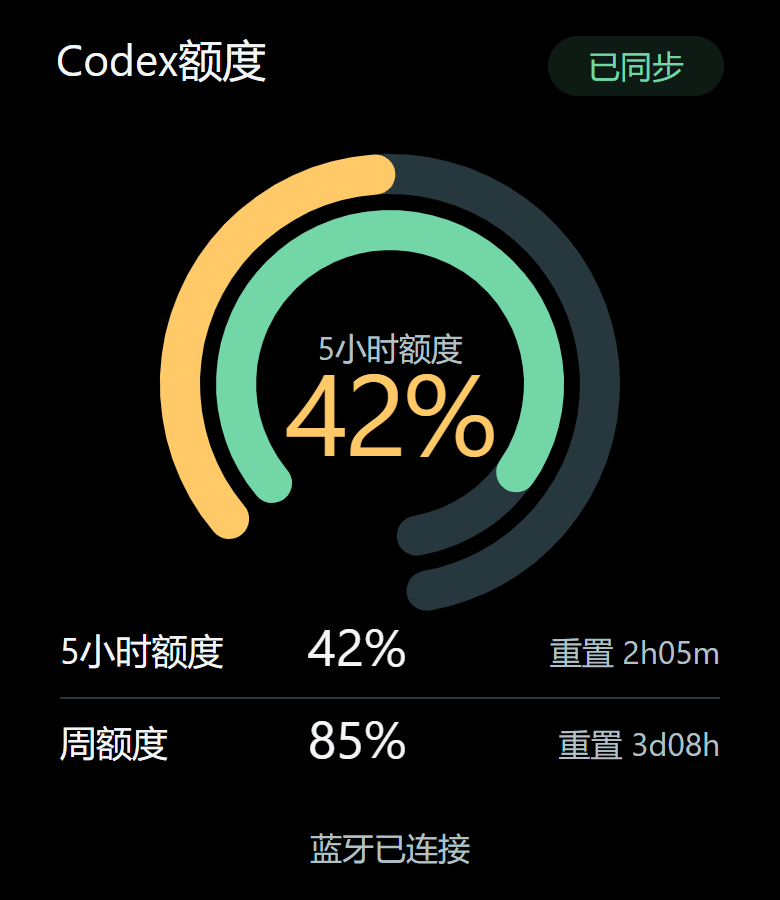

<p align="right"><a href="README_EN.md">English</a></p>

# Codex额度 · 黄山派与小米手环

在黄山派或安卓手机与小米手环 10 上查看 **Codex 额度与重置时间**；手机与手环还可显示当前任务状态。

<p align="center">
  
</p>

<p align="center">
  <strong>当前源码候选：0.6.5 · 最近正式发布：0.6.4</strong>
</p>

## 它能做什么

- 在手机和手环上查看 Codex 5 小时额度、周额度和重置时间。
- Windows 通过蓝牙直接向黄山派同步额度，无需手机；按套餐显示单圈或双圈。
- 查看 ChatGPT Windows 客户端中的任务状态：
  `处理中`、`需要授权`、`等待查看`。
- 在任务需要授权或等待查看时向手机、手环发送提醒。
- 设备间数据通过本地连接传输，不经过本项目的云服务器；Windows 向官方接口确认额度。

## 选择连接方式

| 显示设备 | 连接方式 | 准备条件 |
| --- | --- | --- |
| 黄山派（实验性） | Windows → 加密 BLE → 黄山派 | 支持 BLE 的 Windows 电脑、黄山派及标配 390×450 AMOLED 屏幕 |
| 小米手环 10 | Windows → 局域网 → Android → 小米运动健康 → 手环 | 安卓手机、小米运动健康、手环，手机与电脑处于同一局域网 |

黄山派的连接、布局及 OLED 保护已在本机完成测试；当前账号仅有周额度，真实双窗口触摸仍待对应套餐验证。[黄山派使用说明](#黄山派蓝牙直连实验性)见下文；以下手机与手环安装步骤适用于第二条连接方式。

<table>
  <tr>
    <th align="center">手机首页</th>
    <th align="center">手环首页</th>
  </tr>
  <tr>
    <td align="center"></td>
    <td align="center"></td>
  </tr>
</table>

## 手机与手环：使用前准备

你需要：

- 一台 Windows 10 或 Windows 11 电脑；
- 已登录并正常使用的 ChatGPT Windows 客户端；
- 一台安卓 8.0 或更高版本的手机；
- 小米手环 10；
- 其他版本的小米手环暂未完成真机验证，可能出现页面错位或显示异常，请等待后续版本更新；
- 手机中已安装「小米运动健康」，并已连接手环；
- 手机和电脑连接同一个局域网。

## 下载

请从 [GitHub Releases](https://github.com/Vincent-hechuan/codex-quota-band/releases) 下载同一版本的三个文件。以下为 `0.6.5`：

| 安装位置 | 文件 |
| --- | --- |
| Windows 电脑 | `CodexQuota-Setup-0.6.5.exe` |
| 安卓手机 | `CodexQuota-0.6.5.apk` |
| 小米手环 10 | `CodexQuota-0.6.5.rpk` |

三个文件的版本号必须一致。不要从不明网站下载安装包。

## 安装和连接

### 第一步：安装 Windows 程序

1. 双击 `CodexQuota-Setup-0.6.5.exe`。
2. 安装完成后，Codex额度会出现在任务栏右下角的通知区域；如果没有看到，请点击 `^`。
3. 安装完成页会默认启动程序并显示配对二维码和 6 位配对码。
4. 重启 ChatGPT，在「ChatGPT → 设置 → 钩子 → 信任全部钩子」中确认以下四项已开启：
   `PreToolUse`、`PermissionRequest`、`UserPromptSubmit`、`Stop`。

### 第二步：安装安卓应用

1. 在手机上安装 `CodexQuota-0.6.5.apk`。
2. 打开「小米运动健康」，确认手环仍然在线。
3. 打开手机上的「Codex额度」。
4. 建议在手机系统中为 Codex额度开启：
   - 自启动；
   - 应用加锁；
   - 电池使用不受限制。

这些设置能提高锁屏和后台同步的稳定性，但安卓系统仍可能在内存不足时结束应用。

### 第三步：连接手机和电脑

1. 确认手机和电脑连接同一个局域网。
2. 右键 Windows 通知区域中的「Codex额度」，选择「连接手机…」。
3. 在手机「Codex额度 → 设置」中点击「连接电脑」。
4. 优先选择「扫描二维码」，直接使用 Codex额度内置相机扫描；无法扫码时选择「输入配对码」。
5. 手动配对时输入 Windows 显示的 6 位数字，并确认手机与电脑显示的安全校验码一致。
6. 配对成功后，手机首页会显示电脑“已连接”，额度和任务会自动同步。

二维码和配对码只在 5 分钟内有效，并且成功使用一次后立即失效。手动配对会自动查找同一局域网中的电脑，不需要填写 IP 地址。
Windows 已有配对窗口时，再次点击托盘入口只会把原窗口置前；需要新二维码或配对码时，点击窗口底部的“刷新配对码”。

### 第四步：安装手环应用

AstroBox 只在安装或升级手环应用时临时使用，不参与日常同步。

1. 临时打开 [AstroBox](https://astrobox.online/downloads/)。
2. 进入已连接的小米手环 10 设备页面。
3. 打开「快应用数量」右上角的设置。
4. 点击 `+`，导入 `CodexQuota-0.6.5.rpk`。
5. 等待安装动画结束。
6. 安装完成后退出 AstroBox，重新确认「小米运动健康」仍显示手环已连接。
7. 在手机「Codex额度 → 设置」中点击「检查手环连接」，按系统提示授权。
8. 打开手环上的「Codex额度」，数据通常会在几秒内出现。

## 日常使用

平时只需要保持以下程序正常运行：

- Windows 通知区域中的 Codex额度；
- 安卓手机上的 Codex额度；
- 小米运动健康。

AstroBox 可以退出。

状态含义：

| 状态 | 含义 |
| --- | --- |
| 已同步 | 最近一次额度确认仍然有效 |
| 缓存 | 显示的是上一次可信数据，不是实时数据 |
| 离线 | 手机无法连接电脑或手环 |
| 处理中 | ChatGPT 正在处理任务 |
| 需要授权 | ChatGPT 正在等待你确认操作 |
| 等待查看 | 当前一轮已经停下，等待你查看结果；不代表成功或失败 |

如果上游暂时没有提供 5 小时额度，手机和手环会显示 `-- / 暂无数据`，不会猜测额度。

## 检查更新

手机「Codex额度 → 设置 → 检查更新」会检查本项目公开的 GitHub Release：

- 已是最新版时会显示提示；
- 有新版本时会先显示版本和更新说明；
- 只有你点击“前往下载”后才会打开 GitHub；
- 不会自动下载或安装。

## 常见问题

### 手机扫码后连不上电脑

- 确认手机和电脑在同一个局域网；两端都能上网不代表在同一个局域网。
- 不要使用访客 Wi-Fi、公共 Wi-Fi 或启用了设备隔离的网络。
- 首次启动时，允许 Codex额度通过 Windows 防火墙的专用网络。
- 在 Windows 通知区域打开「连接与诊断…」查看具体状态。

### 手机锁屏后显示缓存

在手机系统中为 Codex额度开启自启动、应用加锁和电池使用不受限制。不同品牌手机的设置名称可能略有不同。

### 手环显示离线或不更新

1. 确认「小米运动健康」仍显示手环已连接。
2. 完全退出 AstroBox，避免它继续占用手环连接。
3. 确认手机、手环安装的是同一版本。
4. 在手机 Codex额度的设置中点击「检查手环连接」。

### 任务状态不可用

1. 在 Windows 通知区域选择「安装/修复任务 Hook」。
2. 重启 ChatGPT。
3. 打开「ChatGPT → 设置 → 钩子 → 信任全部钩子」。
4. 确认四项 Hook 均已开启，然后新建一个任务测试。

### 5 小时额度显示 `--`

这表示当前上游数据中还没有 5 小时额度，不是同步失败。周额度、任务和手环连接仍可正常使用；上游提供数据后会自动显示。

### 重装后可用重置次数显示 `--`

打开 ChatGPT 的使用量页面，展开额度重置相关内容并等待加载完成，然后在 Windows 通知区域选择「刷新当前状态」。

## 隐私说明

- 不读取或传输你的提示词、回复、命令、文件路径、终端输出或完整日志。
- 不读取 ChatGPT Cookie 或登录密码。
- Windows 只在本机使用现有 Codex 访问令牌查询官方额度；令牌不会写入项目日志、诊断、手机或手环。
- 手机与电脑通过加密连接在局域网中同步。
- 不包含广告、遥测或自动崩溃上报。
- 请勿把 Windows 同步端口暴露到公网。

更多说明见 [安全说明](docs/security.md)。

## 卸载

- Windows：在「设置 → 应用 → 已安装的应用」中卸载 Codex额度。
- 安卓手机：直接卸载 Codex额度。
- 小米手环：通过 AstroBox 卸载 Codex额度。

## 开源与开发

这是社区制作的开源项目，不是 OpenAI、小米或 AstroBox 的官方产品。

源码使用 [MIT License](LICENSE)。开发者可阅读：

- [架构说明](docs/architecture.md)
- [开发指南](docs/development-guide.md)
- [安全说明](docs/security.md)
- [贡献指南](CONTRIBUTING.md)

从源码构建安卓应用需要自行从小米官方开发者渠道取得 Wearable SDK。该第三方二进制不随仓库分发。

## 黄山派蓝牙直连（实验性）

黄山派通过已配对、经身份验证和加密的 BLE 连接电脑，日常使用无需 Android 或小米运动健康。当前为源码候选，尚未提供正式发布的黄山派固件或 Windows 安装包；现有 Release 安装包不包含这条新链路。

### 运行界面

<table>
  <tr>
    <th align="center">仅周额度 · 单圈</th>
    <th align="center">双额度 · 同心环</th>
    <th align="center">双额度 · 数据行</th>
  </tr>
  <tr>
    <td align="center"></td>
    <td align="center"></td>
    <td align="center"></td>
  </tr>
</table>

以上为 390×450 界面的示例数据预览，非真机拍摄；实际数值由套餐和同步结果决定。KEY2 切换同心环与数据行布局；当前账号的单圈界面已通过真机验证，双窗口触摸仍待对应套餐验证。

### 显示与操作

- 套餐只有周额度时显示单圈，同时提供 5 小时和周额度时显示同心双环；未知数据与套餐不适用分别处理。
- 剩余额度低于 20% 为红色，20–49% 为黄色，50% 及以上为绿色。5 小时重置倒计时使用 `xhxxm`，周额度使用 `xdxxh`。
- 短按 KEY2 在同心环与“环形图＋数据行”布局之间切换；双窗口时可触摸切换中央额度。开机默认同心布局。
- 断线保留本次开机的 RAM 缓存，并显示离线状态和原始数据年龄；Windows 自动重连。断电重启后等待重新同步。

### OLED 保护

纯黑背景、正常亮度 30%，显示内容每分钟移动一次，最大偏移 ±2px。持续断线 3 分钟后息屏；触摸、短按 KEY2 或重新收到有效蓝牙数据可唤醒。首次触摸或按键只负责唤醒，保持原布局；离线唤醒后重新计时 3 分钟。

无有效蓝牙数据 45 秒会判定断线，随后开始息屏计时。连接正常时保持亮屏，额度来源变为缓存不会单独触发息屏。息屏采用全黑画面和亮度归零，保留触摸共用供电；这是停止显示发光，屏幕电路与蓝牙仍在工作。

### 构建与首次连接

本机使用 [SiFli SDK](https://github.com/OpenSiFli/SiFli-SDK)，板级为 `sf32lb52-lchspi-ulp`。完成 SDK 环境安装后，在仓库根目录运行：

```powershell
.\huangshan-app\scripts\test.ps1
.\huangshan-app\scripts\build.ps1 -SdkRoot D:\UGit\OpenSiFli\sifli-sdk
.\windows-native\scripts\build-huangshan.ps1 -UseMirror
```

1. 按[黄山派工程说明](huangshan-app/README.md)备份受影响区域，并刷入对应的 `bootloader`、`main` 和 `ftab`；保留配对数据，不整片擦除。该固件不是手环 RPK。
2. 在 Windows「设置 → 蓝牙和设备 → 添加设备」中选择 `CodexQuota-HSPI`，输入屏幕显示的 6 位配对码。
3. 运行 `.\windows-native\scripts\run-huangshan.ps1` 启动本地便携候选；或在候选的托盘菜单启用「黄山派蓝牙同步」。之后自动恢复配对连接。

便携候选不会替换原来的安装包或登录启动配置。构建环境、协议和验证范围见[黄山派说明](huangshan-app/README.md)、[BLE 协议](contract/ble-quota-v2.md)和[当前状态](docs/current-status.md)。
